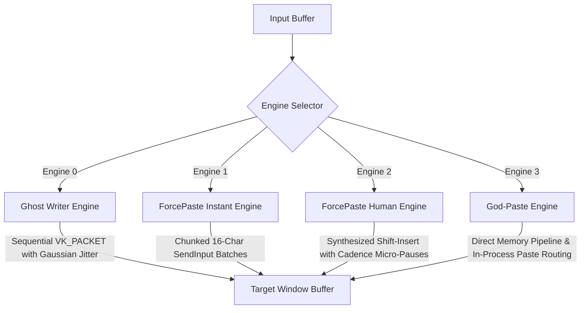

# Cronq AI: High-Performance Non-Intrusive Desktop Overlay & Text Insertion Engine

[](https://github.com/SriramGandhiS/cronqai)
[](https://github.com/SriramGandhiS/cronqai)
[](https://github.com/SriramGandhiS/cronqai)
[](https://github.com/SriramGandhiS/cronqai)
[](LICENSE)

Cronq AI is an ultra-low-overhead, non-intrusive floating desktop overlay and multi-engine input dispatcher. Designed specifically for technical workflows, automated testing, and reference navigation, Cronq operates seamlessly on top of exclusive, borderless, and fullscreen environments without stealing focus from active editor buffers or document models.

---

## Architectural Overview

Cronq decouples the user interface from OS-level input capture and dispatching. It utilizes a zero-activation Win32 layered shell hosting an isolated Microsoft Edge WebView2 runtime, coupled directly with low-level global input hooks and dedicated background worker threads.

```
+--------------------------------------------------------------------------------+
|                               TARGET ENVIRONMENT                               |
|                         (Editor / IDE / Terminal / GUI)                        |
|                                                                                |
|    +----------------------------------------------------------------------+    |
|    | Active Focused Document Model (Retains Unbroken Focus State)         |    |
|    +-----------------------------------^----------------------------------+    |
+----------------------------------------|---------------------------------------+
                                         |
               +-------------------------+-------------------------+
               |        Unified Low-Level Dispatch Subsystem       |
               +------------^-----------------^-----------------^--+
                            |                 |                 |
             +--------------+---+     +-------+-------+     +---+--------------+
             |   Ghost Writer   |     |  ForcePaste   |     |    God-Paste     |
             | (Cadence Jitter) |     | (Batch / Hum) |     |  (Memory-Direct) |
             +------------------+     +---------------+     +------------------+
                                              ^
                                              | Local Asynchronous IPC Bridge
+---------------------------------------------+----------------------------------+
|                            CRONQ OVERLAY SUBSYSTEM                             |
|  +-------------------------------------+   +--------------------------------+  |
|  | Native Core Subsystem (C++17)       |   | UI Runtime (Chromium/WebView2) |  |
|  | * WH_KEYBOARD_LL Event Interception |<->| * Mobile Form-Factor Viewport  |  |
|  | * WH_MOUSE_LL Side-Button Macro     |   | * Dynamic Engine Configurator  |  |
|  | * Non-Activating Window (WS_EX_*)   |   | * Assistant & Context Terminal |  |
|  +-------------------------------------+   +--------------------------------+  |
+--------------------------------------------------------------------------------+
```

---

## Core Capabilities

### Multi-Model AI & Browser Workspace
Instant switching between **ChatGPT**, **Claude**, **Gemini**, **Chrome/Web Browser**, and **Local AI** (offline llama-server bridge) from a 4-column grid.

### Unified Standard Arrow Cursor
Enforces a consistent Windows IDC_ARROW cursor across the overlay, UI controls, resize edges, and embedded WebView2 pages (no I-beam or hand-pointer transitions).

### Screen-Share & Presentation Privacy
Excluded from capture (WDA_EXCLUDEFROMCAPTURE), zero taskbar persistence (ITaskbarList::DeleteTab + WS_EX_TOOLWINDOW), and Ghost Mode (Alt + G) click-through propagation across WebView2 child hosts.

### Non-Activating Window Architecture
Utilizing `WS_EX_NOACTIVATE`, `WS_EX_TOPMOST`, and specialized `WM_MOUSEACTIVATE` routing (`MA_NOACTIVATE`), Cronq permits complex user interaction—scrolling, clicking, reading responses, and configuring parameters—without ever stripping focus from the target IDE, code editor, or command terminal.

### Z-Order Resilience in Fullscreen Environments
Standard topmost windows are frequently occluded or minimized when third-party applications enter borderless or exclusive fullscreen modes. Cronq enforces Z-order retention through recursive ancestor validation (`GetAncestor(hwnd, GA_ROOT)`), layered window clipping adjustments, and periodic topmost re-assertion routines.

### Hardware Macro Integration
The native hook subsystem captures low-level mouse hardware signals (`XBUTTON1` and `XBUTTON2`), mapping them directly to the overlay's core event loops:
- **Mouse Button 4 (`XBUTTON1`)**: Triggers immediate execution of the active text insertion engine.
- **Mouse Button 5 (`XBUTTON2`)**: Toggles overlay visibility instantly without requiring keyboard chords.

### Unoccluded Capture System
Executing `Alt + P` initiates a multi-stage capture sequence: the overlay is dynamically hidden for a single render frame, the raw screen framebuffer behind the application is captured cleanly into system memory, and the overlay is restored instantaneously.

---

## Unified Multi-Engine Input Architecture

Different development environments, virtual desktops, and web-based code editors employ varying validation rules for text input. Cronq provides four interchangeable injection pipelines:



### Detailed Engine Specification

| Engine ID | Mode Designation | Dispatch Mechanism | Performance Profile | Recommended Use Case |
| :---: | :--- | :--- | :--- | :--- |
| **0** | **Ghost Writer** | Sequential Unicode `SendInput` (`VK_PACKET`) with Gaussian latency distribution and simulated typo corrections. | Configurable CPM (100–1200 CPM); deterministic jitter. | Environments logging inter-keystroke intervals or typing dynamics. |
| **1** | **ForcePaste Instant** | High-throughput batched Unicode chunking (16 characters per slice) with zero inter-slice latency. | Maximum throughput; near-instantaneous transfer. | Heavy source files, large configuration scripts, and complex multiline functions. |
| **2** | **ForcePaste Human** | Synthetic paste dispatch paired with calculated micro-hesitations and focus stabilization pre-delays. | Variable delay profile (80–300 ms). | Editors requiring clipboard-event verification with organic timing. |
| **3** | **God-Paste** | In-memory clipboard dispatch targeting the window descriptor without persisting unmanaged OS clipboard states. | Direct memory transfer; bypasses persistent OS histories. | Custom editors with background clipboard history monitors or security hooks. |

---

## Input Matrix & Command Reference

### Keyboard Controls

| Key Binding | Function | Technical Description |
| :--- | :--- | :--- |
| `Alt + X` | Toggle Visibility | Modifies window visibility state without modifying focus. |
| `Alt + W` | Dispatch Engine | Initiates text insertion via the configured engine. |
| `Alt + G` | Click-Through (Ghost) | Applies `WS_EX_TRANSPARENT` to ignore all cursor hit tests. |
| `Alt + C` | Display Profile | Cycles appearance (Solid Dark, Solid Light, Transparent Camouflage). |
| `Alt + P` | Clean Frame Capture | Captures underlying screen pixels without overlay occlusion. |
| `Alt + M` | Input Routing | Toggles between Mirror Mode (split input) and Exclusive Mode. |
| `Alt + A` / `Alt + S` | Opacity Modulation | Modulates window alpha channel in 5% increments. |
| `Alt + D` | Dimension Reset | Restores native 360 x 640 mobile viewport bounds. |
| `Alt + F` | Viewport Expansion | Toggles between compact floating viewport and display fullscreen. |
| `Alt + Left` / `Alt + Right` | Display Docking | Anchors overlay to bottom-left or bottom-right quadrant. |
| `Alt + K` | Security Lockout | Conceals overlay and disables global hook processing. |
| `Alt + K + X` | Security Release | Re-enables global hooks and restores normal operation. |
| `Alt + Shift + K` | Process Termination | Dispatches immediate shutdown signal to native process host. |

### Mouse Macro Controls

| Hardware Event | Function | Technical Description |
| :--- | :--- | :--- |
| `XBUTTON1` (Button 4) | Direct Dispatch | Triggers active text insertion pipeline into foreground window. |
| `XBUTTON2` (Button 5) | Overlay Toggle | Cycles visibility of the overlay interface. |
| Drag Header | Translation | Relocates window coordinates across multi-monitor topologies. |
| Drag Frame Edges | Scaling | Resizes viewport dimensions while enforcing minimum aspect boundaries. |

---

## Technical Specifications

| Parameter | Windows Implementation | Linux Implementation |
| :--- | :--- | :--- |
| **Core Architecture** | C++17 (Native Win32 Subsystem) | C11 (GNU / POSIX Subsystem) |
| **Rendering Subsystem** | Microsoft Edge WebView2 (Evergreen) | WebKitGTK 4.1 |
| **Input Interception** | `WH_KEYBOARD_LL`, `WH_MOUSE_LL` | X11 / XInput2 Record Protocol |
| **Click-Through Routing** | Win32 Layered Attributes (`WS_EX_TRANSPARENT`) | X11 XShape Extension |
| **Dispatch Pipeline** | Win32 `SendInput` (`VK_PACKET`, `INPUT_KEYBOARD`) | X11 XTest Protocol Extension |
| **Inter-Process Comm.** | Named Windows Pipes / Win32 Messaging | POSIX Domain Sockets |
| **Target Footprint** | ~35 MB Private Working Set | ~45 MB RSS Memory |

---

## Build and Deployment

### System Requirements
- **Windows**: Windows 10 (Build 19041+) or Windows 11 (64-bit). Microsoft Edge WebView2 Runtime.
- **Toolchain**: Visual Studio 2022 (Desktop development with C++), CMake 3.20+, Ninja build system.

### Compilation

```powershell
# Clone the repository
git clone https://github.com/SriramGandhiS/cronqai.git
cd cronqai

# Generate CMake configuration
cmake -S windows -B windows/build -A x64

# Compile Release target
cmake --build windows/build --config Release

# Package and register locally
powershell -NoProfile -ExecutionPolicy Bypass -File windows/installer/make-dist.ps1
powershell -NoProfile -ExecutionPolicy Bypass -File windows/installer/install.ps1
```

### Verification Suite

Cronq includes a CTest verification harness covering engine logic, timing stability, and serialization:

```powershell
ctest --test-dir windows/build --output-on-failure
```

```
Test project D:/Linux-Handy-overlay/windows/build
      Start  1: GhostLogicTest.ComputesCorrectBaseDelay
 1/22 Test  #1: GhostLogicTest.ComputesCorrectBaseDelay ........   Passed    0.02 sec
      Start  2: GhostLogicTest.AppliesVarianceWithinRange
 2/22 Test  #2: GhostLogicTest.AppliesVarianceWithinRange ......   Passed    0.02 sec
...
22/22 Test #22: GhostTimingConfigTest.RoundTripsThroughIni .....   Passed    0.02 sec

100% tests passed, 0 tests failed out of 22
Total Test time (real) =   0.40 sec
```

---

## Configuration Architecture (`config.ini`)

Runtime configurations are stored at `%APPDATA%\cronq\config.ini`:

```ini
[General]
width = 360
height = 640
corner = bottom-left
opacity = 0.98
start_visible = true
default_key_mode = mirror

[Appearance]
mode = 0                  # 0: Solid Dark, 1: Solid Light, 2: Camo Dark, 3: Camo Light

[GhostTiming]
engine = 1                # 0: Ghost Writer, 1: ForcePaste Instant, 2: ForcePaste Human, 3: God-Paste
cpm = 360                 # Characters per minute (for cadence-based engines)
variance_ms = 40          # Natural timing variation boundary
typo_rate = 0.00          # Error frequency percentage for simulated typing
```

---

## Disclaimers & Intended Use

Cronq AI is developed for personal developer productivity, automated regression testing, accessibility enablement, and technical exploration. It is distributed under the terms of the MIT License. Users are responsible for adhering to applicable acceptable use policies when interfacing with third-party software environments.
