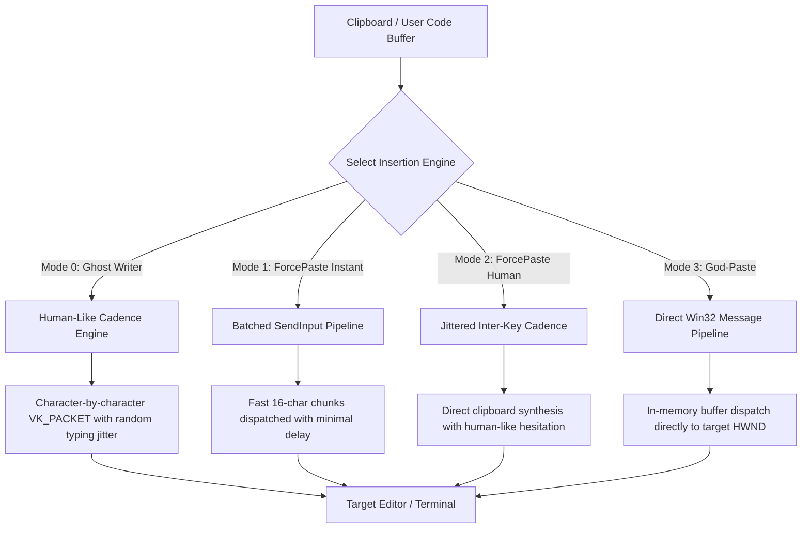
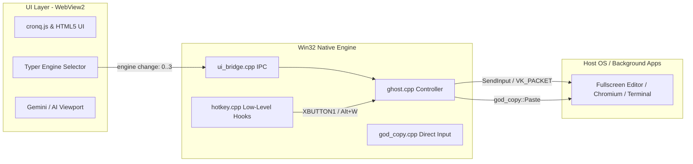

# 📱 Cronq AI (Cronq)

**The resilient, non-intrusive floating assistant overlay designed for developers, researchers, and automated workflows.**  
Floats persistently above desktop environments — including borderless and fullscreen applications — while maintaining non-stealing focus, hardware mouse macros, clean screenshots, and a unified 4-engine text insertion architecture.

---

```
  ┌────────────────────────────────────────────────────────────────────────┐
  │                           TARGET APPLICATION                           │
  │                      (IDE / Editor / Fullscreen)                       │
  │                                                                        │
  │   ┌────────────────────────────────────────────────────────┐           │
  │   │  Active Focused Document Model                         │           │
  │   └──────────────────────▲─────────────────────────────────┘           │
  └──────────────────────────┼─────────────────────────────────────────────┘
                             │
            ┌────────────────┴────────────────┐
            │   4-Mode Text Insertion Hub     │
            │   (Low-Level Direct Dispatch)   │
            └──────▲────────▲────────▲────────┘
                   │        │        │
     ┌─────────────┴──┐ ┌───┴────┐ ┌─┴─────────────┐
     │  Ghost Writer  │ │ Force  │ │   God-Paste   │
     │ (Human Cadence)│ │ Paste  │ │ (Win32 Bypass)│
     └────────────────┘ └────────┘ └───────────────┘
                             ▲
                             │ Direct IPC Event Bridge
  ┌──────────────────────────┴─────────────────────────────────────────────┐
  │                            CRONQ OVERLAY                               │
  │  ┌───────────────────────┐         ┌────────────────────────────────┐  │
  │  │ Win32 Native Core     │ ◄─────► │ Microsoft Edge WebView2 Engine │  │
  │  │ • WH_KEYBOARD_LL Hook │         │ • Clean Mobile Viewport        │  │
  │  │ • WH_MOUSE_LL Hook    │         │ • Gemini / AI Integration      │  │
  │  │ • Layered Window Mgmt │         │ • Dynamic Typer Controller     │  │
  │  └───────────────────────┘         └────────────────────────────────┘  │
  └────────────────────────────────────────────────────────────────────────┘
```

---

## ⚡ Key Highlights & Core Capabilities

- **Zero Focus Stealing (`WS_EX_NOACTIVATE`)**: Interact with Cronq, inspect AI answers, or trigger scripts without moving cursor focus or losing document state in your background IDE or fullscreen terminal.
- **Topmost Z-Order Persistence**: Hardened against aggressive fullscreen games and custom electron editors using periodic topmost re-assertion and layered window clipping.
- **Hardware Mouse Macro Support**: Trigger and toggle operations hands-free using mouse side buttons (`Mouse Button 4` & `Mouse Button 5`).
- **Clean Screenshot Tooling**: `Alt + P` hides the overlay for a split second, captures the raw display behind it without watermark or occlusion, saves the capture, and loads it to the clipboard.
- **Camouflage & Click-Through (Ghost Mode)**: Instantly transition to `Alt + G` click-through or `Alt + C` transparent text mode for unobtrusive reference viewing.
- **Unified 4-Engine Insertion Pipeline**: Tailor code and text delivery to the target editor's specific event model.

---

## 🚀 The 4-Mode Text Insertion Architecture

Cronq includes four distinct text insertion engines built to handle different editor buffers, event loops, and input constraints:



| Engine | ID | Primary Mechanism | Best Used For |
| :--- | :---: | :--- | :--- |
| **Ghost Writer** | `0` | Sequential Unicode `SendInput` (`VK_PACKET`) with natural millisecond jitter and optional simulated typos. | Simulating authentic human typing cadence into editors that log typing speed. |
| **ForcePaste Instant** | `1` | High-throughput batched `SendInput` (16-char chunks) with zero delay between chunks. | Large code blocks, functions, and multiline scripts where maximum speed is desired. |
| **ForcePaste Human** | `2` | Direct synthetic paste dispatch combined with variable delays and natural micro-pauses. | Applications requiring paste actions with non-robotic timing intervals. |
| **God-Paste** | `3` | Memory-buffered clipboard simulation that loads text and triggers insertion directly. | Editors with custom clipboard inspectors or background event monitors. |

---

## ⌨️ Global Shortcuts & Controls

All keyboard shortcuts operate globally system-wide.

| Shortcut | Action | Description |
| :--- | :--- | :--- |
| **`Alt + X`** | **Toggle Overlay** | Show or hide the Cronq interface instantly. |
| **`Alt + W`** | **Trigger Insertion Engine** | Initiates active typing/pasting into the target background window. |
| **`Alt + G`** | **Ghost / Click-Through** | Makes Cronq transparent to all mouse clicks. |
| **`Alt + C`** | **Camouflage Mode** | Switches between Solid Dark, Light, and Camo transparent display. |
| **`Alt + P`** | **Clean Screenshot** | Captures the screen behind the overlay cleanly into your clipboard. |
| **`Alt + M`** | **Typing Mode** | Toggles Mirror (overlay + background) ⇄ Exclusive mode. |
| **`Alt + A` / `Alt + S`**| **Opacity** | Increase / decrease overlay transparency. |
| **`Alt + D`** | **Default Size** | Resets window dimensions to 360 × 640 mobile aspect ratio. |
| **`Alt + F`** | **Fullscreen** | Toggles overlay between compact phone view and fullscreen. |
| **`Alt + ←` / `Alt + →`**| **Docking** | Snaps window to bottom-left or bottom-right corner. |
| **`Alt + K`** | **Panic Lock** | Hides overlay and locks hotkeys. Unlock with **`Alt + K + X`**. |
| **`Alt + Shift + K`** | **Emergency Quit** | Prompt to terminate process cleanly. |

### 🖱️ Mouse Macros

| Input | Action |
| :--- | :--- |
| **Mouse Button 4 (`XBUTTON1`)** | **Trigger Insertion Engine**: Starts typing text from the Typer buffer into the background app without touching the keyboard. |
| **Mouse Button 5 (`XBUTTON2`)** | **Toggle Overlay**: Instantly shows or hides the Cronq overlay. |
| **Drag Header** | Move the overlay window anywhere on your display. |
| **Drag Borders / Corners** | Freely resize the overlay viewport. |

---

## 🛠️ Architecture & Under-the-Hood



- **Native Core (`C++17`)**:
  - `WH_KEYBOARD_LL` & `WH_MOUSE_LL` hooks intercept configured triggers with near-zero latency.
  - Safe ancestor validation (`GetAncestor(hwnd, GA_ROOT)`) prevents accidental focus interruption when targeting nested Chromium window classes (`Chrome_RenderWidgetHostHWND`).
  - Thread-isolated execution guarantees that long insertion sequences never block UI responsiveness or event pumps.
- **Frontend Layer (Microsoft Edge WebView2)**:
  - Lightweight, responsive HTML5/ES6 application layer.
  - Persistent settings stored in local `%APPDATA%\cronq\config.ini`.
  - Zero external web dependencies required for core functionality.

---

## 📦 Installation & Setup

### Prerequisites

- **Windows 10 (Version 2004+ / Build 19041+) or Windows 11 (64-bit)**
- **Microsoft Edge WebView2 Runtime** (included by default on Windows 11 and recent Windows 10 updates)
- For building from source: **Visual Studio 2022** (Desktop C++ workload), **CMake 3.20+**, and **Ninja** or MSBuild.

### Building from Source

```powershell
# Clone the repository
git clone https://github.com/SriramGandhiS/cronqai.git
cd cronqai

# Configure CMake build
cmake -S windows -B windows/build -A x64

# Compile Release binaries
cmake --build windows/build --config Release

# Package and install locally
powershell -NoProfile -ExecutionPolicy Bypass -File windows/installer/make-dist.ps1
powershell -NoProfile -ExecutionPolicy Bypass -File windows/installer/install.ps1
```

### Running the App

After installation, run from PowerShell or Command Prompt:

```powershell
cronq
```

Or run the background daemon directly:
```powershell
& "$env:LOCALAPPDATA\Programs\Cronq\cronqw.exe"
```

---

## 🧪 Testing & Verification

Cronq includes an automated CTest test suite covering the ghost logic, timing profiles, config serialization, and insertion modes:

```powershell
ctest --test-dir windows/build --output-on-failure
```

*Status: 22/22 unit tests passing (100% pass rate).*

---

## ⚙️ Configuration Reference (`config.ini`)

Located at `%APPDATA%\cronq\config.ini`:

```ini
[General]
width = 360
height = 640
corner = bottom-left
opacity = 0.98
start_visible = true
default_key_mode = mirror

[Appearance]
mode = 0                  # 0: Solid Dark, 1: Solid Light, 2: Camo Dark, 3: Camo Light

[GhostTiming]
engine = 1                # 0: Ghost Writer, 1: ForcePaste Instant, 2: ForcePaste Human, 3: God-Paste
cpm = 360                 # Characters per minute (for paced modes)
variance_ms = 40          # Natural timing jitter
typo_rate = 0.00          # Error simulation rate
```

---

## 🛡️ Responsible Use & Disclaimers

Cronq is designed for personal productivity, accessibility, testing, and authorized developer automation workflows. It is provided under the project's open-source license. Ensure compliance with terms of service for any third-party platforms with which you use assistive automation tools.
